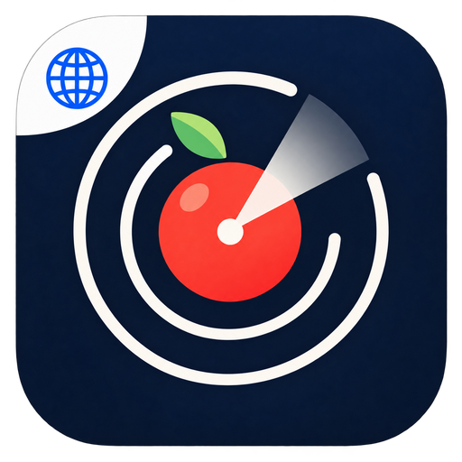
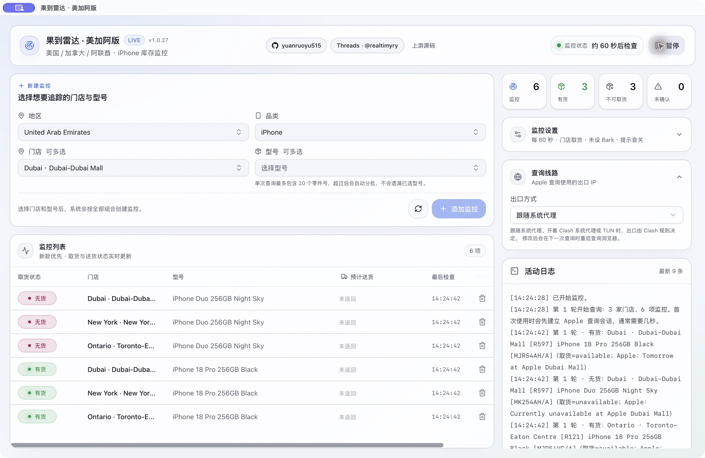
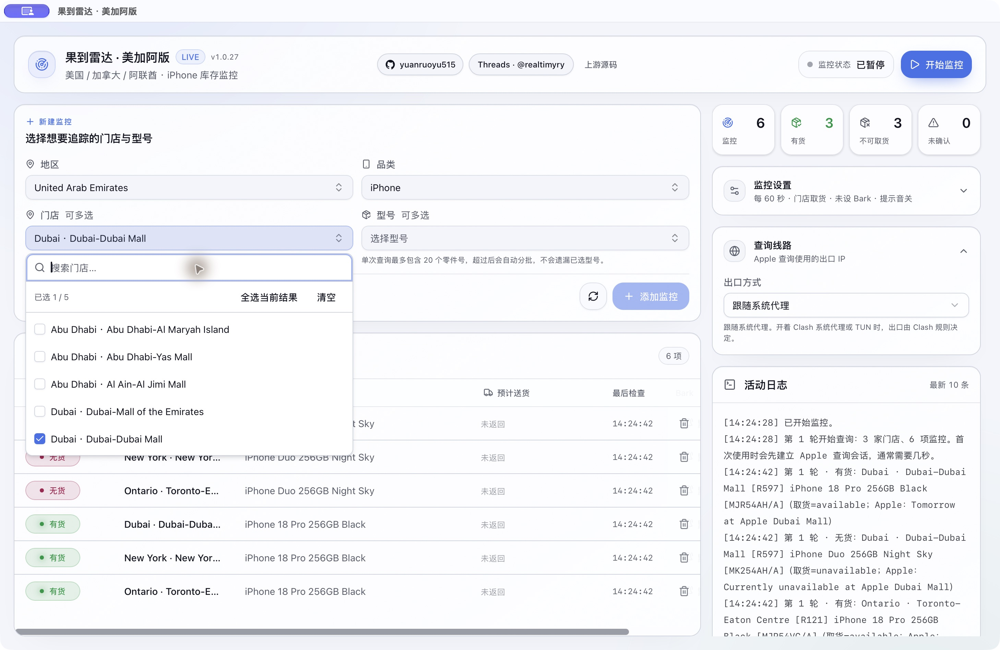
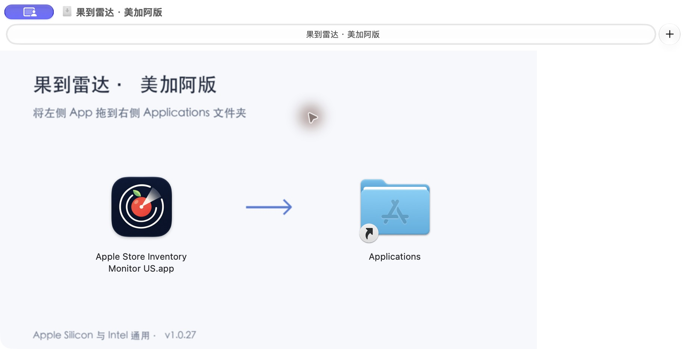

<p align="center">
  
</p>

<h1 align="center">果到雷达 · 美加阿版</h1>

<p align="center">
  <strong>选好门店和型号，有货时及时知道。</strong><br>
  美国、加拿大、阿联酋 Apple Store 取货库存监控，运行在你的 Mac 上。
</p>

<p align="center">
  <a href="https://github.com/yuanruoyu515/apple-store-inventory-monitor/releases/download/v1.0.27-us.2/Apple-Store-Inventory-Monitor-US-macOS-universal-1.0.27.dmg">
    
  </a>
</p>

<p align="center">
  <a href="#开始使用">开始使用</a> ·
  <a href="https://github.com/yuanruoyu515/apple-store-inventory-monitor/releases">版本记录</a> ·
  <a href="https://www.threads.com/@realtimyry">Threads @realtimyry</a>
</p>

<p align="center">
  
</p>

<p align="center"><sub>v1.0.27 实机截图，拍摄于 2026-10-29。库存仅代表拍摄时 Apple 返回的结果。</sub></p>

<a id="这一版更新了什么"></a>

## 把反复刷新，交给雷达

果到雷达会按设定间隔查询你选中的门店与型号。Apple 明确返回可取货时，可以播放提示音、把消息推送到 iPhone，或打开对应国家的购物袋和商品页。你继续在 Apple 官网确认并完成购买。

这是由 **[yuanruoyu515](https://github.com/yuanruoyu515)** 维护的地区修改版，基于 **[suversal 的果到雷达 v1.0.26](https://github.com/suversal/apple-store-inventory-monitor/tree/v1.0.26)** 继续适配。现有用户可以覆盖升级，保留原来的监控、Bark 与声音设置。

- **多门店、多型号一起看。** 按州、省、酋长国、城市或店名搜索，多选后一次添加；美国、加拿大和阿联酋的监控可以共存。
- **提醒送到你需要的地方。** 支持电脑提示音、Bark 手机推送和页面跳转，也能给某个型号单独设置 Bark 地址。只想收到一次提醒，可开启「到货后暂停监控」。
- **减少重复查询。** 复用应用专属浏览器会话，合并同城取货请求；响应缺少准确门店或型号时补查。查询线路可跟随系统代理，也可使用自己配置的 Clash 节点。
- **每次查询都有记录。** 查看最后检查时间、门店编号、零件号和 Apple 原始取货说明。被拦截、未返回型号或尚未开放取货时，保留相应状态。

<a id="地区目录与边界"></a>

## 三国目录，各用各的

| 地区 | 内置 Apple Store | iPhone 配置 | 地区料号 |
| :--- | ---: | ---: | :--- |
| United States / 美国 | 269 家 | 40 个 | `LL/A` |
| Canada / 加拿大 | 28 家 | 40 个 | `VC/A` |
| United Arab Emirates / 阿联酋 | 5 家 | 40 个 | `AH/A` |

三国均包含 **iPhone Duo、iPhone 18 Pro、iPhone 18 Pro Max** 的容量与颜色组合。各国使用独立料号、当地查询入口及购物袋，美国以外不携带美国运营商参数。

阿联酋目录包括 **Dubai Mall、Mall of the Emirates、Al Maryah Island、Yas Mall、Al Jimi Mall**。门店和型号来自 Apple 官方公开页面，目录快照不代表当前库存。

<details>
<summary>看看门店搜索与多选</summary>

<p>
  
</p>

美国与加拿大也使用相同的搜索、多选方式。切换国家时会重新加载当地目录，已有监控继续保留。

数据来源与地区实现说明：[美国](README_US.md) / [加拿大](README_CA.md) / [阿联酋](README_AE.md)。美国门店地址与 ZIP code、阿联酋目录于 2026-10-29 核对；美加型号与加拿大门店保留先前独立核对的快照。

</details>

<a id="下载与安装"></a>

## 拖过去，就装好了

**一个通用 DMG，同时支持 Apple Silicon 与 Intel。** 不用区分芯片，也不需要安装开发工具。

<p align="center">
  
</p>

1. 点击页首「下载 macOS 通用 DMG」，打开下载的镜像。
2. 把左侧 App 拖到右侧 **Applications（应用程序）** 快捷图标。
3. 从「应用程序」打开 App。Mac 还需要安装 **Google Chrome 或 Microsoft Edge**，供后台查询使用。

升级时，先从菜单栏完全退出旧版，再替换同名 App。为兼容旧版，应用文件名仍是 `Apple Store Inventory Monitor US.app`；窗口名称为「果到雷达 · 美加阿版」。

当前应用版本为 **1.0.27**，Release 标签为 **v1.0.27-us.2**。发布页同时提供对应源码、安装说明和 SHA-256 校验文件。请从本仓库下载修改版，上游安装包不包含本版的三国适配。

<details>
<summary>macOS 提示无法打开或 App 已损坏？</summary>

当前安装包采用 ad-hoc 签名，已校验两个架构的应用签名，但没有 Developer ID 签名或 Apple 公证。首次打开被拦截时，到「系统设置 → 隐私与安全性」确认本应用后选择「仍要打开」。

确认 DMG 来自本仓库、SHA-256 与发布页一致，仍无法打开时，可只移除此 App 的下载隔离标记：

```sh
xattr -dr com.apple.quarantine "/Applications/Apple Store Inventory Monitor US.app"
```

不需要关闭 macOS 的全局安全功能。

</details>

<a id="开始监控"></a>

## 开始使用

**选择门店与型号。** 在地区中选择 United States、Canada 或 United Arab Emirates，勾选门店、型号、容量与颜色，点击「添加监控」。

**设好提醒。** 按需开启提示音、填写 Bark 地址，并选择到货后是否打开购物袋或商品页。先点「测试提醒与跳转」，确认提醒方式可用。

**开始监控。** 新安装默认每 **60 秒** 查询一次；升级保留原间隔。关闭主窗口后，App 可以留在 Mac 菜单栏继续运行。使用时请保持电脑唤醒。

<details>
<summary>把到货提醒推送到 iPhone</summary>

在 iPhone 上安装 Bark，把形如 `https://api.day.app/你的BarkKey` 的推送地址填入 App。可以设置通知等级、铃声、音量和持续响铃；这些效果还取决于 Bark 和 iPhone 的通知权限。

监控列表也支持为某个型号设置专属地址。BarkKey 属于推送凭证，反馈问题时请隐去完整地址。Bark 负责接收通知，Mac 负责运行监控。

</details>

<details>
<summary>查询线路与 HTTP 541</summary>

本版带入了上游的持久浏览器会话、真实浏览器身份、同城响应复用和查询线路设置。这些改进可以减少重复请求，**不能保证消除 Apple HTTP 541**。

- **跟随系统代理 / 指定节点：** 遇到拦截后停止当轮同地区的其他请求，下一轮按设定间隔重试。
- **Clash 节点轮换：** 被拒的节点进入冷却，尝试其他可用节点；全部不可用时等待恢复。需要自己配置并运行 Clash，软件不提供代理或节点。

不要连续点击查询或把间隔调得很短。监控范围较大或持续被拦截时，延长间隔或暂停后再试。541 表示本次查询无法确认库存，不能当成无货。

</details>

<details>
<summary>库存状态与使用范围</summary>

**有货 / 无货**来自 Apple 本次明确返回的取货结论；「待开放取货」「暂无取货数据」「请求被拦截」等状态分别保留原意，不触发有货提醒。Apple 给出的「再查」日期也不是可取货承诺。

预计送货列只展示 Apple 实际返回的信息。本版没有增加三国收货地址或邮编送达时间查询，不能用送货信息推断门店库存。

本版提供监控、提醒和页面跳转，不开放上游仅适配中国大陆的自动结账。软件不预留库存、不自动付款。Mac 休眠、关机、断网或彻底退出 App 后，监控会停止。最终库存和购买结果以 Apple 官网为准。

</details>

## 开源与开发

使用 **Rust、Tauri 2、React 与 TypeScript** 构建。查询使用应用专属的 Chrome / Edge 资料目录，不读取日常浏览器的登录状态或浏览记录。修改版保留独立应用标识和配置目录，并通过自己的 GitHub Releases 手动更新。

<details>
<summary>从源码构建</summary>

<a id="从源码构建"></a>

需要 Rust 1.90+、Node.js 24、pnpm 和 Xcode Command Line Tools。

```sh
git clone --branch us-edition https://github.com/yuanruoyu515/apple-store-inventory-monitor.git
cd apple-store-inventory-monitor
pnpm install --frozen-lockfile
pnpm generate:regions
pnpm test
cargo test --workspace
pnpm tauri build --bundles app
```

App 输出到 `target/release/bundle/macos/Apple Store Inventory Monitor US.app`。

发布时分别构建并校验 Apple Silicon 与 Intel 应用，再用 [通用 DMG 打包脚本](scripts/package-universal-dmg.py) 合并为通用 App，写入 Applications 快捷图标与 Finder 布局。完整构建步骤见 [发布工作流](.github/workflows/release.yml)。

</details>

<details>
<summary>版本验证与数据维护</summary>

v1.0.27 发布前，342 项 Rust 测试分别在 Apple Silicon 和 Intel（Rosetta）运行通过，74 项前端测试通过。真实 Chromium 查询已验证美国、加拿大、阿联酋，以及跨地区会话切换。通用 App 包含 `arm64` 与 `x86_64`，DMG 挂载后的签名和 Applications 链接也经过检查。

数据生成使用已提交的快照，不要求构建时访问 Apple。`pnpm generate:regions` 生成三国目录；维护者可用 `pnpm refresh:ca`、`pnpm refresh:ae` 与 `scripts/refresh-us-stores.mjs` 核对相应官方数据。

[更新记录](CHANGELOG.md) / [完整 Release](https://github.com/yuanruoyu515/apple-store-inventory-monitor/releases)

</details>

<a id="来源与反馈"></a>

## 维护与来源

修改版维护：[GitHub @yuanruoyu515](https://github.com/yuanruoyu515) / [Threads @realtimyry](https://www.threads.com/@realtimyry)。反馈请附 App 版本、Mac 芯片、国家、门店编号、型号与相关日志，隐去 BarkKey 和个人信息。

本项目基于 [suversal/apple-store-inventory-monitor](https://github.com/suversal/apple-store-inventory-monitor) 修改，更早来源包括 [ENCHIGO/apple-pickup-watcher](https://github.com/ENCHIGO/apple-pickup-watcher) 与 [hteen/apple-store-helper](https://github.com/hteen/apple-store-helper)。感谢原作者与贡献者。上游文档保存在 [README_UPSTREAM.md](README_UPSTREAM.md)。

继续按 **[GPL-3.0-or-later](LICENSE)** 发布，保留原作者署名、许可和 [修改声明](NOTICE)。本项目不是 Apple 官方软件，与 Apple Inc. 没有隶属或授权关系。
