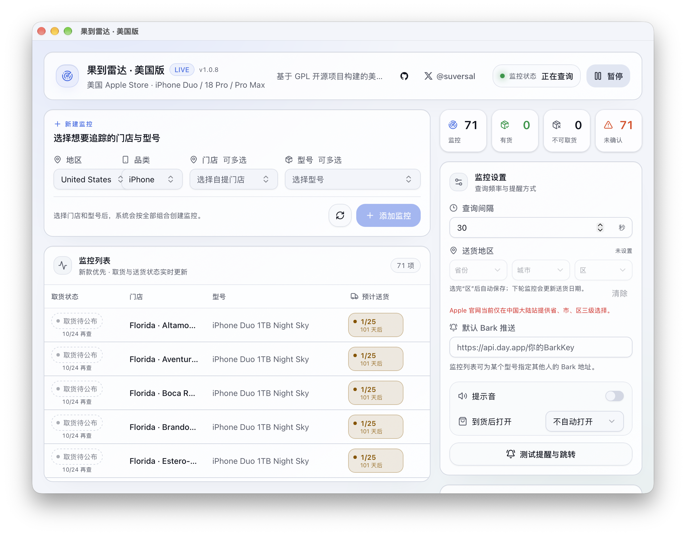
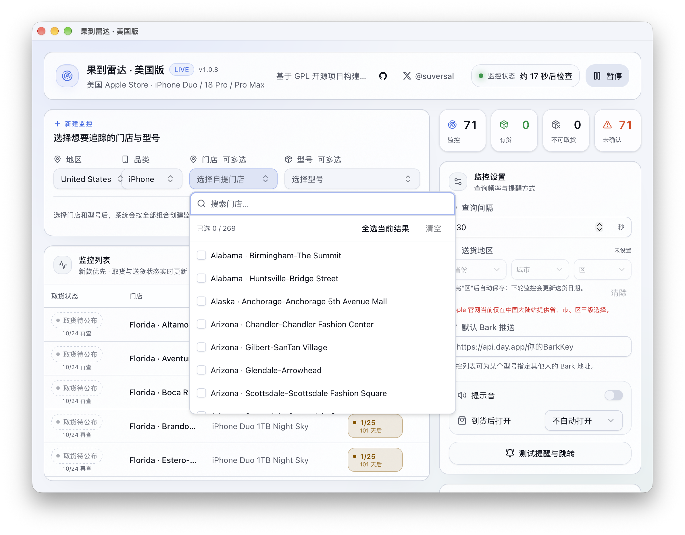

<div align="center">

# 果到雷达 · 美加修改版 🇺🇸 🇨🇦

### Apple Store Inventory Monitor US

监控美国与加拿大 Apple Store 的 iPhone 库存，有货时提醒你。

**美加版维护：[yuanruoyu515](https://github.com/yuanruoyu515)** · 基于 suversal 的开源项目修改

[](https://github.com/yuanruoyu515/apple-store-inventory-monitor/releases/latest)
[](https://www.threads.com/@realtimyry)


[](https://github.com/yuanruoyu515/apple-store-inventory-monitor/releases/tag/v1.0.9-us.1)
[](LICENSE)

[下载美加版](https://github.com/yuanruoyu515/apple-store-inventory-monitor/releases/latest) · [安装与使用](#下载与安装) · [加拿大说明](README_CA.md) · [Threads：@realtimyry](https://www.threads.com/@realtimyry)

</div>

> [!IMPORTANT]
> **要监控美国或加拿大门店，请下载本仓库 `yuanruoyu515/apple-store-inventory-monitor` 的美加修改版。**
> **v1.0.9 起支持 Canada。** 为兼容旧版升级，安装包文件名仍含 `US`，应用仍叫 `Apple Store Inventory Monitor US.app`，新版窗口标题为「果到雷达 · 美加版」。不要从上游原作者的 Releases 下载。



*你的 Mac 负责查询，Bark 可以把到货消息推到 iPhone。截图为 v1.0.8 美国界面；v1.0.9 在地区中增加 Canada。库存与日期仅代表截图时 Apple 返回的信息，不是当前库存承诺。*

## 这个版本能做什么

这是由 **yuanruoyu515 维护的美加地区修改版**，不是 Apple 官方应用，也不是上游原版的官方地区发行。保留原项目的桌面监控方式，补上美国与加拿大门店、各自的型号与查询参数。

- 内置 **269 家美国门店、28 家加拿大门店** 的快照，可按州／省、城市、店名或门店编号搜索，多选门店与型号。
- 支持 **iPhone Duo、iPhone 18 Pro、iPhone 18 Pro Max** 的容量和颜色组合，美国与加拿大各 40 个独立 SKU，不混用地区料号。
- 定时检查门店取货状态，分别显示预计送货时间、最后检查时间和活动日志；开始、暂停与查询间隔都可调整。
- 确认有货时可播放提示音、发送 **Bark 推送**，也可自动打开 Apple 购物袋或商品页。持续有货时，可能按轮询间隔重复提醒。
- 关闭主窗口后可留在 Mac 菜单栏继续监控。使用独立的应用标识与配置目录，不覆盖原版设置。
- 按门店合并查询，带请求间隔、随机抖动与失败退避。被拦截或无法确认时显示未知，不冒充无货。

**它不会自动付款、预留库存或代下单。** 打开购物袋后仍需自己确认型号、门店并完成结账，能否买到以 Apple 官网为准。

## 下载与安装

### 1. 只从这里下载美加版

**[→ 打开美加修改版最新下载页](https://github.com/yuanruoyu515/apple-store-inventory-monitor/releases/latest)**

当前发布为 `v1.0.9-us.1`，应用内显示 `v1.0.9`。同一个安装包支持美国与加拿大，提供以下两种 macOS 架构：

| 你的 Mac | 下载 v1.0.9 美加版 |
| --- | --- |
| Apple 芯片（M 系列） | [macOS-arm64 ZIP](https://github.com/yuanruoyu515/apple-store-inventory-monitor/releases/download/v1.0.9-us.1/Apple-Store-Inventory-Monitor-US-macOS-arm64-1.0.9.zip) |
| Intel 芯片 | [macOS-Intel ZIP](https://github.com/yuanruoyu515/apple-store-inventory-monitor/releases/download/v1.0.9-us.1/Apple-Store-Inventory-Monitor-US-macOS-Intel-1.0.9.zip) |

在「苹果菜单 → 关于本机」查看芯片。普通用户下载上表中的 ZIP 即可，不需要 Rust、Node.js，也不要把 GitHub 自动生成的 `Source code` 当成安装包。发布页另附对应源码、使用说明和 SHA-256 校验文件。

### 2. 安装到应用程序

1. 完全退出正在运行的旧美国版／美加版。
2. 解压 ZIP，将 **`Apple Store Inventory Monitor US.app`** 拖进「应用程序」。替换同名应用即可，已有美国监控、Bark 与声音设置会保留。
3. 在 Mac 的 `/Applications` 中安装 **Google Chrome 或 Microsoft Edge**，查询时需要其中一种。Safari 不能替代它们。
4. 打开应用。安装包采用 ad-hoc 签名，没有 Developer ID 签名及 Apple 公证，macOS 可能拦截。

若被拦截，可在「系统设置 → 隐私与安全性」确认是本应用后选择「仍要打开」；系统允许时也可在 Finder 中按住 Control 点击应用并选择「打开」。

确认安装包来自**本仓库的 Release**，仍提示已损坏或无法打开时，可只移除这个应用的下载隔离标记：

```bash
xattr -dr com.apple.quarantine "/Applications/Apple Store Inventory Monitor US.app"
```

不要对来源不明的应用执行此命令，也不需要关闭 macOS 的全局安全功能。

## 开始监控

1. 地区选 **United States** 或 **Canada**，品类选 **iPhone**。
2. 打开门店选择，输入州／省、城市或店名，比如 `Florida`、`Miami`、`Ontario`、`Toronto`，勾选想去的门店。
3. 选择型号、容量和颜色。可在型号搜索中输入 `Duo`、`Pro Max` 或容量筛选。
4. 点击「添加监控」。多门店与多型号会按组合生成监控项，建议先从附近少量门店开始。
5. 按需开启提示音、填写 Bark 地址、选择「到货后打开」方式，点击「测试提醒与跳转」。
6. 点击「开始监控」，保持 Mac 唤醒。默认查询间隔为 30 秒，实际查询也受请求节流、门店数量与失败退避影响。



切换地区只影响新建监控所用的目录，不会删除已添加的监控；可以同时保留美国与加拿大门店。新地区目录载入期间会清空旧的候选项，避免把两国料号混在一起。

### 支持的美加型号

| 型号 | 存储容量 | 颜色 |
| --- | --- | --- |
| iPhone Duo | 256GB / 512GB / 1TB / 2TB | Night Sky / Star White |
| iPhone 18 Pro | 256GB / 512GB / 1TB / 2TB | Black / Burgundy / Glacier / Silver |
| iPhone 18 Pro Max | 256GB / 512GB / 1TB / 2TB | Black / Burgundy / Glacier / Silver |

以上为本版本内置的数据快照，并不表示每个配置当前都能下单或到店取货。美国使用 `en_US`、`LL/A` 料号与 `UNLOCKED/US` 参数；加拿大使用 `en_CA`、`VC/A` 料号与 `/ca` 查询入口，不带美国运营商参数。料号与来源分别见 [美国技术说明](README_US.md) 和 [加拿大技术说明](README_CA.md)。软件不判断融资、运营商激活或合约资格，这些以 Apple 结账页面为准。

### Bark 手机推送

在 iPhone 安装 Bark，复制自己的推送地址，填入应用的「默认 Bark 推送」：

```text
https://api.day.app/你的BarkKey
```

也可使用自己的 Bark 服务。监控列表支持为特定型号指定其他 Bark 地址，填好后先发送测试提醒。**BarkKey 相当于推送凭证，不要贴进公开日志、截图或 GitHub。**

Bark 只负责接收通知，不负责运行监控。Mac 休眠、关机或彻底退出应用后，就不会继续检查库存。关闭主窗口但仍留在菜单栏时，监控可以继续。

## 怎么看库存状态

| 界面状态 | 含义 |
| --- | --- |
| 有货 / 可取货 | 本次查询明确返回可取货，可以触发提醒；仍需在官网确认并下单 |
| 无货 / 不可取货 | 本次查询明确返回不可取货，不等于以后不会补货 |
| 取货待公布 | Apple 尚未给出明确取货结果，不算有货，也不算无货，不触发有货提醒 |
| 未知、请求被拦截、响应解析失败等 | 本次查询无法确认库存，查看逐项日志；不能据此判断无货 |

Duo 预购阶段可能显示「取货待公布」及「10/24 再查」之类的提示。再查日期来自 Apple 每次响应，**不是保证可取货的日期**。预计送货时间是另一项信息，也不能用它推断门店取货库存。

## 常见问题

### 下载后为什么没有 United States 或 Canada？

先确认下载地址的仓库所有者是 **`yuanruoyu515`**，文件名中有 **`US`**，打开的是 **`Apple Store Inventory Monitor US.app`**。Canada 需 v1.0.9 或更新版本。上游原版与本修改版是不同的发行包，不能混用下载链接。本版已关闭上游更新检查，后续请从[本仓库 Releases](https://github.com/yuanruoyu515/apple-store-inventory-monitor/releases/latest)手动更新。

### Apple HTTP 541 或连接异常怎么办？

541 表示 Apple 拒绝了这次请求，不能当成无货。应用会用隔离的 Chromium 会话查询，并在失败后延长重试间隔，但不能保证绕过 Apple 的风控。不要连续点击查询或把间隔调得很短；可暂停后再试，并对照 Apple 官网、网络状态及活动日志排查。

应用不会读取日常 Chrome / Edge 的浏览器资料。查询所用的独立会话，并不保证能消除所有拦截。

### 可以关窗口吗？电脑可以睡眠吗？

关主窗口后留在菜单栏，可以继续监控；选择退出应用就会停止。电脑睡眠、关机或断网时无法正常查询。这是本机 macOS 应用，不是全天运行的云端服务。

### 有 Windows、Linux 或 iPhone 版吗？

本仓库当前发布的是 **macOS 美加修改版**，提供 Apple Silicon 与 Intel 安装包，不承诺其他平台的美加版安装包。iPhone 可以通过 Bark 收通知，但监控程序仍运行在 Mac 上。

## 维护者与反馈

美加版修改、打包与发布由 **[yuanruoyu515](https://github.com/yuanruoyu515)** 维护。使用问题或本版反馈，可以在 Threads 找我：

[](https://www.threads.com/@realtimyry)

**[@realtimyry](https://www.threads.com/@realtimyry)** · https://www.threads.com/@realtimyry

反馈时请附应用版本、Mac 芯片类型、所选国家、门店编号、型号和相关日志，隐去 BarkKey 与个人信息。本修改版的问题请先反馈给本版维护者，不要把本版特有问题提交给上游作者。

## 来源与开源许可

本仓库是 [suversal/apple-store-inventory-monitor](https://github.com/suversal/apple-store-inventory-monitor) **v1.0.6** 的修改版。监控框架、界面与基础功能来自原作者及贡献者，美国／加拿大适配和本版后续修改由 yuanruoyu515 维护，原作者与贡献者署名继续保留。

更早的来源包括 [ENCHIGO/apple-pickup-watcher](https://github.com/ENCHIGO/apple-pickup-watcher/tree/v0.3.2) 与 [Hteen/apple-store-helper](https://github.com/hteen/apple-store-helper)。完整来源、版权和带日期的修改声明保留在 [NOTICE](NOTICE)，上游原版文档归档在 [README_UPSTREAM.md](README_UPSTREAM.md)，**它不是本美加修改版的安装指南**。

本修改版继续按 **GPL-3.0-or-later** 发布，许可全文见 [LICENSE](LICENSE)。Release 同时提供对应源代码；再分发或继续修改时，应遵守该许可并保留相关声明。美国版技术变更与构建方法见 [README_US.md](README_US.md)。

本项目与 Apple Inc. 无隶属或授权关系，也不代表上游作者背书。所有库存与购买结果以 Apple 官网为准。

## 从源码构建

需要 Rust 1.90+、Node.js、pnpm 和 Xcode Command Line Tools。请克隆**本仓库的美国分支**：

```bash
git clone --branch us-edition https://github.com/yuanruoyu515/apple-store-inventory-monitor.git
cd apple-store-inventory-monitor
pnpm install --frozen-lockfile
pnpm generate:na
pnpm test
cargo test --workspace
pnpm tauri build --bundles app
```

应用输出到 `target/release/bundle/macos/Apple Store Inventory Monitor US.app`。双架构构建命令见 [美国版技术说明](README_US.md#从源码构建)。
